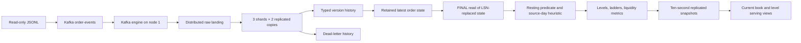

# Pipeline design

This document explains the topology, book semantics, metric contract and serving behavior for parts A–C and optional sharding. See the [root README](../README.md) for startup, usage, validation commands and the task-to-document map. Read [FINDINGS.md](FINDINGS.md) for the trust assessment required by part D.

## Topology and data flow

The cluster `orderbook_cluster` has **three shards and two replicas per shard**:

| Shard | Replica 1 / HTTP host port | Replica 2 / HTTP host port |
|---|---|---|
| 1 | `clickhouse-1` / 8123 | `clickhouse-4` / 8126 |
| 2 | `clickhouse-2` / 8124 | `clickhouse-5` / 8127 |
| 3 | `clickhouse-3` / 8125 | `clickhouse-6` / 8128 |

AKHQ starts with the default stack and is available at [localhost:8080](http://localhost:8080).

Native ports are 9000–9005 in node-number order. Keeper runs on nodes 1–3 with a three-member Raft quorum. `SHARD_ID` and `REPLICA_NAME` provide table-path macros. Each node has its own persistent volume. Kafka is one plaintext broker, topic replication factor one; ClickHouse replication factor two does not make Kafka highly available. Local ports bind to loopback. Credentials are `orderbook` / `local-dev-password`; these are development credentials.



Raw routing uses `cityHash64(toString(id))` for valid IDs and a message hash otherwise. All versions of an order stay on one shard. Typed and latest Distributed tables use the same ID hash. Snapshot history is sharded by market ID. `internal_replication=true` sends a Distributed insert to one replica; `Replicated*MergeTree` propagates the stored parts to its peer. The small market reference table intentionally has one shared Keeper path and six copies so every coordinator can join it locally.

SQL is installed on all six nodes by the migration runner; the Kafka engine and its materialized view are installed only on node 1. Parsing materialized views run on whichever replica receives the original insert. Their target tables are also replicated; part replication does not rerun parsing on the peer. Kafka-to-raw and snapshot inserts request foreground Distributed delivery and quorum two. This improves acknowledgement durability, but the chained views and Kafka offset commit are not a transaction across tables. Monitor routing and replication errors and retain replayable inputs.

All serving views exist on every node. Distributed reads select one replica per shard, avoiding double-counting. `orders_current` reads retained `ReplacingMergeTree(lsn)` state with `FINAL`, resolving pending replacements on each shard before live-order filtering. All versions of an ID must stay on the same shard; misplaced versions across shards are not reconciled. Changing shard count requires explicit resharding. See [architecture and operations](OPERATIONS.md) for details.

## SQL layout

The SQL folders follow the pipeline layers: 01_reference → 02_ingestion → 03_orders → 04_validation → 05_book → 06_snapshots → 07_serving. Scheduled snapshot queries and monitoring queries are grouped separately. See the [SQL architecture guide](SQL.md) for the directory tree, dependencies and execution order.

## Book semantics and metric contract

`__LSN` determines source precedence. Arrival offset, Kafka time, update time, and creation time do not. Current state is selected before applying any live-order filters; otherwise an old active image can survive its later close/delete. Equal-LSN redeliveries are assumed identical; replacement does not define a source-level winner for conflicting same-LSN images, which need a source contract.

A resting candidate has `op != 'd'`, `mode = 'limit'`, `state = 'active'`, no cancel request, no settled-in-match flag, positive `amount1 - exchanged1`, and positive price. Bots and all services remain included. We then keep only candidates whose latest commit is on the latest observed source date in `Asia/Tehran`. This is the explicit stale-order heuristic, inferred from events, not from ground truth and not from today's wall clock. It excludes genuine unchanged overnight orders and fails if stale images receive fresh commits. A future-dated outlier can also advance the cutoff incorrectly.

Levels sum unfilled base amounts by market, side and exact price. Notional is remaining base × limit price; `amount2 - exchanged2` is not substituted. Ladders contain `(price, base_volume, quote_notional)` tuples, bids descending and asks ascending. Empty markets stay visible, with null touch prices, zero level counts, and empty ladders. `is_crossed=1` means bid ≥ ask when both sides exist; a zero flag on an empty book is not evidence of tradable liquidity.

| Output | Meaning |
|---|---|
| `best_bid`, `best_ask` | Highest bid / lowest ask |
| `second_bid`, `second_ask` | Next distinct level; null if absent |
| `spread` | Ask minus bid in price units |
| `bid_gap`, `ask_gap` | Best-to-second absolute price distance; null if absent |
| `*_depth_count` | Level counts in inclusive bands `[0.1%, 0.5%, 1%, 2%, 5%]` from that side's touch |
| `*_depth_volume` | Quote notional in the same band order |
| `fill_thresholds` | IRT: 50M, 100M, 200M, 500M, 1B, 2B, 5B, 10B; USDT: 500, 2k, 5k, 10k, 20k, 50k, 100k |
| `*_fill_impact` | Relative move to the first level whose cumulative notional meets the matching threshold; null if insufficient |

Prices use `Decimal(38,7)`, base amounts `Decimal(76,18)`, and notionals `Decimal(76,25)`. Relative impacts use explicit `divideDecimal(...,18)`, truncating only below 18 fractional places. No monetary calculation in the pipeline uses floats. All stored timestamps explicitly use `Asia/Tehran`.

## Serving and history

Consumers should query `orderbook.current_book` or `orderbook.current_book_levels`. Both read persisted scheduled snapshots. `liquidity_metrics`, `book_ladders`, and `book_levels` are derivation/debug views and recompute when queried.

```sql
SELECT market_id, snapshot_at, source_as_of, best_bid, best_ask, spread, is_crossed
FROM orderbook.current_book ORDER BY market_id;

SELECT market_id, side, price, base_volume, quote_notional
FROM orderbook.current_book_levels WHERE market_id = 1 ORDER BY side, price;

SELECT snapshot_at, market_id, spread
FROM orderbook.liquidity_metrics_history
WHERE snapshot_at >= toDateTime('2026-10-30 00:00:00', 'Asia/Tehran')
  AND snapshot_at < toDateTime('2026-10-31 00:00:00', 'Asia/Tehran')
  AND market_id = 1 ORDER BY snapshot_at;
```

Snapshots run every ten seconds, subtracting computation time from the interval. The final small-fixture check averaged 331.5 ms across four inserts (363 ms maximum), supporting that cadence locally; see the [validation record](VALIDATION.md) for its limits. If a run takes longer, the next starts immediately; jobs never overlap. `snapshot_at` is the query start time. A market falls out of `current_book` automatically once its latest snapshot is older than 30 seconds, even if historical rows remain. `source_as_of` separately exposes source progress: a fresh computation over the August fixture is still historical data. Production needs feed heartbeat/sequence monitoring; computation freshness alone cannot prove exchange freshness.

Raw events, typed versions, dead letters, and snapshots have seven-day TTLs based on ingestion/snapshot time, not the old fixture's event time. TTL deletion is asynchronous. Raw, dead-letter, version-history and snapshot partitions are daily. The latest-state table uses 16 ID-hash partitions, has no TTL and compacts to one image per ID, including tombstones. It prevents dormant-order loss or resurrection after history expiry, but distinct historical IDs still accumulate. Safe tombstone retirement requires a replay watermark and authoritative checkpoint; arbitrary expiry would sacrifice correctness.


## Cost of calculating live orders

`orders_latest_local` is partitioned by `cityHash64(id) % 16`, not by date, and sorted by `id`. Versions of an order must meet in the same partition for background replacement, including updates and deletes arriving on different days. Daily version and snapshot histories have seven-day TTLs; retained latest state does not.

Consequently, `orders_current FINAL` and the `live_orders` predicate operate over a retained population that grows with distinct order IDs, including closed orders and tombstones. The source-day filter in `book_levels` does not provide date-partition pruning on this table. A small final live book therefore does not imply a cheap reconstruction. Snapshot computation can scan retained state repeatedly for the source-date cutoff, source watermark and ladders, with distributed aggregation adding network cost. The ten-second cadence is validated only on the supplied fixture.

Production work should measure rows read, duration and memory as retained IDs grow, reduce repeated scans, and maintain an incrementally updated active-order projection backed by authoritative checkpoints. Retire closed state and tombstones only with a replay watermark that prevents old messages from resurrecting orders. Adding a date partition or arbitrary TTL to latest state alone would compromise reconciliation.
