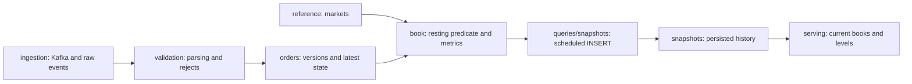

# SQL architecture

The folders follow the data from Kafka ingestion to consumer-facing books. Each SQL file defines one table, materialized view, view, or operational query. Filenames retain their migration identifiers so changes remain easy to trace.

```text
sql/
├── migrations/                 Schema and transformation definitions
│   ├── reference/              Market codes and quote currencies
│   ├── ingestion/              Kafka queue → replicated raw landing
│   ├── validation/             Parse accepted events; capture rejected messages
│   ├── orders/                 Version history → retained latest → current order
│   ├── book/                   Resting orders → price levels → ladders → metrics
│   ├── snapshots/              Replicated, sharded snapshot history
│   └── serving/                Fresh current books and chart-friendly levels
└── queries/                    Runtime operations rather than schema installation
    ├── snapshots/              Scheduled INSERT of metrics and ladders
    └── monitoring/             Diagnostics and actionable alert checks
```

## How the layers connect



| Folder | Responsibility and main objects |
|---|---|
| `migrations/reference` | `markets`, available locally on every node for joins |
| `migrations/ingestion` | `kafka_events_queue`, `mv_kafka_to_raw`, `raw_events_local`, `raw_events` |
| `migrations/validation` | `mv_raw_to_versions`, `mv_raw_to_dead_letter`, dead-letter local and Distributed tables |
| `migrations/orders` | Accepted version tables, retained latest-state tables, `mv_versions_to_latest`, `orders_current` |
| `migrations/book` | `live_orders`, `book_levels`, `book_ladders`, `liquidity_metrics`; includes the explicit source-day heuristic |
| `migrations/snapshots` | Local replicated history and its Distributed wrapper; includes ladders and source timestamps |
| `migrations/serving` | `current_book` with 30-second expiry and `current_book_levels` derived from persisted arrays |
| `queries/snapshots` | `insert_liquidity_snapshot.sql`, executed by the ten-second Python scheduler |
| `queries/monitoring` | `diagnostics.sql` for investigation; `alerts.sql` for alert conditions |

`*_local` tables store data on a shard's replicas. Their Distributed counterparts route writes and read one replica per shard. Both belong together in their architectural layer. Book views compute intermediate results on demand; serving views expose scheduled persisted snapshots.

## Installation order

Use the documented Compose startup command. The [migration runner](../src/orderbook/clickhouse/migrations.py) resolves paths relative to `config/clickhouse.json`'s `sql/migrations` directory and applies dependencies explicitly:

1. Create the database and reference table.
2. Create raw landing tables.
3. Create order-version and dead-letter destinations, then their parsing views.
4. Create retained latest-order storage and its materialized view, then current orders.
5. Create resting-order, level, ladder and metric views.
6. Create snapshot-history tables, then serving views.
7. Attach Kafka ingestion after every downstream destination exists.

Do not apply files by alphabetically walking folders or sorting migration IDs. For example, parsing lives in `validation` but requires the version destination in `orders`; Kafka ingestion is installed last despite its early migration identifiers. Query files are not migrations: the scheduler executes snapshot insertion, while operators run monitoring SQL separately.

Schemas are intended for clean deployment. The repository's [operations guide](../docs/OPERATIONS.md) explains replication, retention, failure boundaries and commands. [FINDINGS.md](../FINDINGS.md) documents the accuracy limits of the reconstruction.
